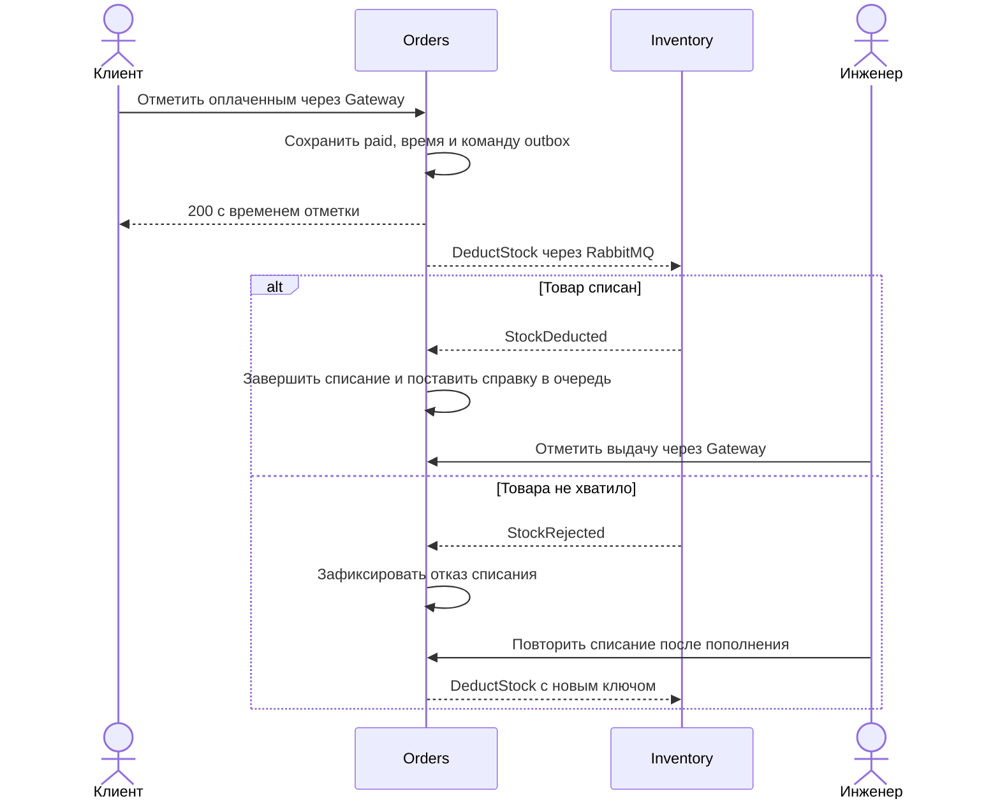

# ADR-043. Отметка оплаты и отдельное списание в v3

## Статус

Принято для v3. Меняет старт и компенсацию оплаты из ADR-030. Сохраняет складское условие выдачи из ADR-021 и запуска справки из ADR-035.

## Решение

- Клиент-владелец отмечает активный заказ оплаченным. Orders сохраняет `status = paid`, время `paid_at` и команду списания в одной транзакции. Успешный повтор возвращает тот же `paid_at` без создания второй попытки. Дашборд и отчёт по выручке используют время подтверждения оплаты.
- Inventory применяет существующее идемпотентное списание. Пока ответ не получен, списание ожидается. При нехватке запасов инженер видит отказ. Отметка оплаты сохраняется в обоих случаях. После пополнения инженер может вызвать `POST /orders/{id}/stock/retry`. Для этого повтора применяется новый ключ попытки. Повтор доставки той же команды сохраняет старый ключ.
- Успешный результат списания разрешает выдачу и ставит задачу на формирование PDF в транзакции обработки ответа. Готовые справки и прежняя схема повторов сборки сохраняются. Разрешение на выдачу проверяет Orders.
- При переключении сначала остановить старт оплат v1, завершить активные попытки и дать примениться компенсациям. Миграция переносит время подтверждения завершённых оплат v1 из времени успешного завершения саги. Если оставшуюся попытку завершает обработчик v3, он сохраняет это время в транзакции завершения списания. Повтор отметки возвращает сохранённое время. Состояние этих списаний и готовые PDF используются повторно.

| Списание | Оплата | Выдача | Запуск PDF |
| --- | --- | --- | --- |
| Ожидается, включая недоступный Inventory | Подтверждена | Заблокирована | Ожидает списания |
| Inventory отклонил списание | Подтверждена | Заблокирована | Ожидает успешной попытки |
| Списано | Подтверждена | Разрешена | Ставится в очередь воркера |

